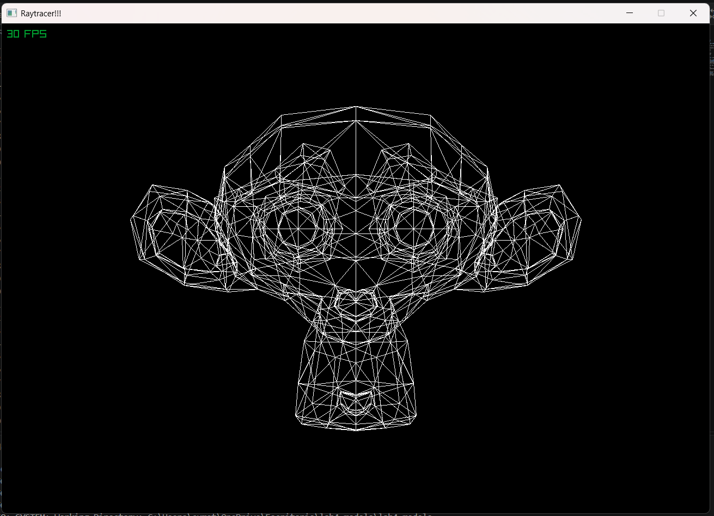

# lab4_modelo
## Resultado



Proyecto con Zig **0.16.0** y raylib **6.0**.

Desde esta carpeta:

```powershell
zig version
zig build
zig build test
zig build run
```

`zig build run` abre la ventana de ejemplo; Escape la cierra.

La dependencia `raylib_zig` queda fijada en `build.zig.zon` al commit
`bd161c82d4cc42d9ea7986d0c6a86daaae79e430`, que actualiza los bindings a
Zig 0.16 y raylib 6.0. Zig descarga las dependencias al compilar por primera vez.
No es necesario ejecutar `zig fetch` nuevamente.

Para restaurar esa misma dependencia:

```powershell
zig fetch --save=raylib_zig git+https://github.com/raylib-zig/raylib-zig#bd161c82d4cc42d9ea7986d0c6a86daaae79e430
```

El commit anterior (`aa9ee05...`) usa APIs antiguas de Zig, como
`std.mem.trimLeft` y `std.process.getEnvVarOwned`. Las ramas actuales de
raylib-zig requieren Zig 0.17; por eso se fija un commit compatible en lugar
de seguir una rama. `zig fetch` descarga paquetes, no cambia el compilador Zig.
